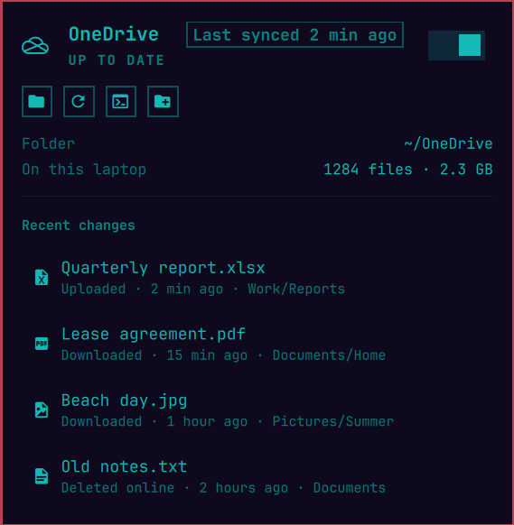

# OneDrive for the Omarchy bar

A bar widget for the [OneDrive Client for Linux](https://github.com/abraunegg/onedrive)
(abraunegg). It shows whether your files are up to date, lets you pause or
resume syncing, lists what changed recently, and lets you choose which folders
sync to this computer, all without leaving the desktop.



## What it shows

The cloud icon in the bar shows the state inside the cloud:

| Cloud shows | Meaning |
|---|---|
| ✓ check | Up to date |
| ⟳ turning arrows | Syncing (or starting up) |
| ‖ pause bars, dimmed | Paused |
| ! exclamation mark, in red | Something needs attention (a failed upload, an expired sign-in, a missing service) |
| Crossed-out outline cloud | Offline, or the OneDrive client isn't installed |

The symbol is cut out of the cloud, so it reads on any bar style, including
transparent ones. With Omarchy's animations turned off, the arrows don't turn.

Click it to open the panel:

- **Status and last sync time**, with a switch to pause or resume syncing.
- **Buttons** to open the OneDrive folder, sync now, show the sync log, and choose folders.
- **Where your files are** and how much space they take on this computer.
- **Recent changes**: files downloaded, uploaded or deleted since you logged in. Click one to show it in Files.

Right-click the icon to refresh, middle-click to open the OneDrive folder.
In the panel: **O** open folder, **S** sync now, **P** pause/resume, **L** log,
**F** choose folders, arrow keys and **Enter** to open recent files.

## Choosing folders

The folder picker shows your OneDrive folders with tick boxes. Tick what you
want on this computer, untick what you don't, and click **Apply**. A terminal
window opens and runs the one-time `--resync` the client needs after a
`sync_list` change, then background syncing starts again.

- Your previous `sync_list` is backed up next to it (`sync_list.bak.<time>`).
- Comments and exclusion rules (`!`, `-`) in `sync_list` are kept as they are.
- It never saves an empty selection by accident. Unticking everything doesn't sync the whole drive; use **Sync my entire OneDrive** for that.
- Unticking a folder stops it syncing. Its files stay on OneDrive, and the copy already on this computer is left in place for you to delete if you want.

### Sync my entire OneDrive

Tick **Sync my entire OneDrive** at the top of the picker and click **Apply** to
mirror the whole drive. The picker backs up `sync_list`, removes it, and runs
the resync. The panel's **Syncing** row then says *Entire OneDrive*.

Choose this if you move or rename folders online. With only some folders
selected, a folder moved online to a place outside your selection stays behind
on this computer as a copy the client no longer tracks. Deleting that copy
while syncing is running can delete the moved folder online. With the whole
drive synced, every move happens here too.

A `sync_list` with wildcard or exclusion rules is never removed this way, so
those rules aren't lost; edit it by hand instead. To go back to chosen
folders, untick the option, tick your folders and click **Apply**.

### How the picker reads your folders (please read)

Listing folders through the client itself means scanning the whole drive, which
can take many minutes. So the picker asks Microsoft Graph for **folder names
only**, read-only, using the client's existing sign-in:

- It reads the client's `refresh_token` and redeems it with Microsoft for a
  short-lived access token, using the client's own app registration and the
  least-privileged scope Microsoft accepts (`Files.Read` first).
- **It never writes the client's token file.** The short-lived access token is
  kept in a file only you can read under `$XDG_RUNTIME_DIR` (memory-backed,
  cleared at logout). The cache folder and file must be owned by you, closed to
  everyone else and not symlinks, or the token isn't cached. Without
  `$XDG_RUNTIME_DIR` it isn't cached at all; it never goes to `/tmp`.
- It only contacts `login.microsoftonline.com` and `graph.microsoft.com`, over
  HTTPS, and never follows redirects, so the token can't be forwarded elsewhere.
- It respects `application_id`, `azure_tenant_id` and `drive_id` from the
  client's config, so business accounts and SharePoint libraries work.
  National clouds (`azure_ad_endpoint`) are not supported by the picker.

If you'd rather the widget never talk to Microsoft, turn off **Folder picker**
in the widget settings. Everything else works from local information only.

## What it reads

Apart from the picker, the widget only reads local information and never changes your files:

- The client's systemd unit (running or not), via `systemctl`.
- The client's `monitor-status.json` (client v2.5.10 and later), for the sync state.
- The client's log in the journal, for recent file changes and error messages.
- The client's `config` and `sync_list`, and the size of your OneDrive folder on disk.

Pause, resume and sync now are `systemctl --user stop/start/restart` on the client's unit.

## Requirements

- Omarchy with the Omarchy shell
- The OneDrive Client for Linux **v2.5 or later**, signed in and running as a
  **systemd user service** (`systemctl --user enable --now onedrive`)
- `python3` (already part of Omarchy)

## Install

```bash
omarchy plugin add https://github.com/GittyIO/omarchy-onedrive.git --enable
```

## Remove

```bash
omarchy plugin remove gittyio.onedrive
```

This removes only the widget. The OneDrive client, your files, its `config`
and `sync_list` stay as they are. Any `sync_list.bak.*` backups the folder
picker made are in the client's config folder (`~/.config/onedrive`); delete
them if you don't need them.

## Update

```bash
omarchy plugin update gittyio.onedrive
```

## Settings

In the widget settings, or on the widget's entry in `~/.config/omarchy/shell.json`:

| Setting | Default | What it does |
|---|---|---|
| `refreshIntervalSec` | `15` | How often the status is checked |
| `configDir` | empty | The client's `--confdir`; empty means `~/.config/onedrive` |
| `serviceName` | `onedrive` | The systemd unit that runs the client |
| `serviceScope` | `user` | `system` shows a system service read-only (no pause, sync now or folder picker) |
| `folderPicker` | `true` | Show the folder picker (see above) |

**Two accounts?** Add the widget twice and point the second one at the other
account's `configDir` and `serviceName` (for example `~/.config/onedrive-work`
and `onedrive-work`).

## Development

```bash
tests/run.sh
```

The tests cover the log and status-file readers, the folder rules (including
refusing an empty selection and unsafe paths), markup-shaped file names, the
display helpers and the translations. They never touch the network or your real
OneDrive config. `node` is needed for the display-helper tests.

Translations live in `i18n/` (English and German so far). Other languages fall
back to English; new catalogs are welcome.

## License

MIT
